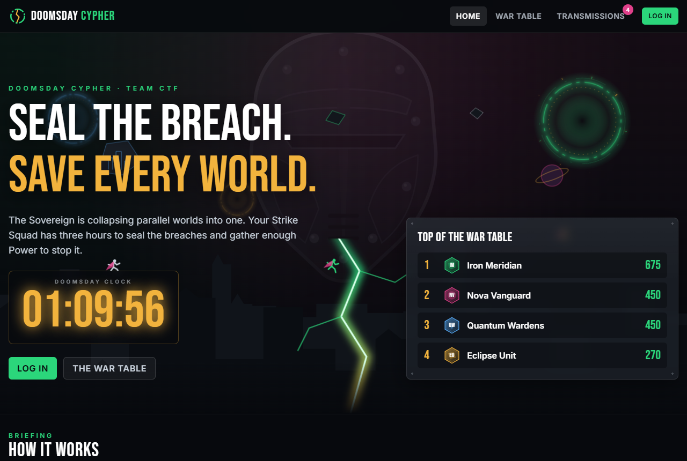

# DOOMSDAY CYPHER

**Seal the breach. Save every world.**

A team Capture The Flag platform for a 3-hour event run by the **Deakin Research & Technology Club**.
An original masked tyrant, **The Sovereign**, is collapsing parallel worlds into one. Strike Squads
seal breaches (challenges) to earn Power (points). Most Power when the Doomsday Clock hits zero wins.

All characters, emblems and illustrations are original SVG/CSS. No franchise names or likenesses.
Home page photos are free-licence Unsplash images, self-hosted in `public/images/` (see Photo credits).

The UI uses plain CTF words: Challenges, Waves (exactly 5 challenges), Points, Teams, Scoreboard,
Admin, Announcements and the Timer. Flags look like **`IAMDOOM{...}`**.



## Features

This site is the warm-up for **EcoCypher** and works the same way, so admins and players only learn
one system: waves of 5 or single challenges, the event clock (or no time limit), hints that cost
points, shared attempt limits, pop-ups for every flag moment, the Python workspace, and the same admin pages.

**Players**
- Log in by picking your team, tapping your name and entering your password. Forcing people to replace a temporary
  password on first login is a setting (Admin → Settings), off by default.
- Breaches page: squad header with emblem, count-up Power, rank, member chips and the Doomsday Clock;
  latest transmission; category filters; single breaches then incursion waves ("x of 5 sealed").
- Breach window: briefing, files, hints with a confirm step (cost charged once, visible to the whole
  squad, shows who opened it), shared attempt limits, flag box that opens/closes with the clock.
- Challenges stay hidden (no titles at all) until Admin starts the event clock; the page then fills
  in by itself. Hints and the flag box say they open when the clock starts.
- Superpower pop-ups: every flag submission plays an effect picked at random (secure random source,
  never the same one twice in a row). Correct: lightning hammer, force shield, web catch, energy
  blast, ground smash, portal or bullseye arrow. Wrong: A.R.I.A. (an original holographic
  assistant), force-shield block, stuck in a web, swallowed by a portal, screen crack or turned to
  dust. The guess that leaves one attempt plays in amber ("ONE ATTEMPT LEFT"), the one that uses the
  last attempt in red ("LOCKDOWN"). The site plays no sounds. On the Pop-ups page Admin can lock an
  effect, and set the text, time on screen and an optional meme image for each moment (also per challenge).
- Python workspace (optional per challenge): Python 3 runs in the player's browser (Pyodide,
  self-hosted in `public/pyodide/`) with numpy, pandas and the standard library. The challenge's
  own `files/…` links are ready to open by name. 30-second limit per run, Stop button. Code never
  reaches the server.
- Easter eggs on the challenges page (no points): the Konami code or the peeking portal starts a
  multiverse frenzy; clicking your team's points 3 times turns on Australia mode.
- War Table: portal race, step chart for the top 5, rank-change arrows, new-leader confetti,
  expandable member Power bars, hint spending in red, freeze/hidden states.
- Transmissions with unread badge and toasts.

**Command**
- Dashboard: clock controls (start, +10 min, remove time limit, end, reset), KPIs, solves over time,
  solves by category, live submission feed, top teams, up next, challenge health.
- Clock length or **no time limit** (Settings): with no limit the clock counts up until End now.
- Post breaches: incursion wave (exactly 5, auto-numbered) or single; post now / schedule / draft;
  CSV/JSON import with per-row errors and review before posting; downloadable template.
- Breach library: release now, schedule, unpublish, edit (flag kept if left empty), delete, +3 attempts
  for every squad, per-breach solves/attempts/hints, "Release this wave now", tick 5 single
  challenges to **make a wave**, **split a wave** back into singles.
- Pop-ups: for each moment (wrong flag, last attempt left, out of attempts, correct flag) set the
  big text, how long it stays up, and an optional meme image; preview it exactly as players see it.
  Upload PNG/JPG/GIF/WEBP memes (≤ 1 MB each, several at once). Images are stored outside the event
  data and served from `/api/media`. SVG is refused (it can carry scripts).
- Squads & members: create, CSV import, credentials shown once (copy / print), rename, add member,
  reset password, remove member, delete squad.
- Transmissions, filterable submission log (wrong guesses included; wrong answers typed by more
  than one team are marked "Shared answer"), settings (event, 4 editable difficulty levels,
  scoreboard show/hide/freeze, backup export/import, start fresh, load demo).
- Start fresh clears teams, challenges, submissions and announcements but keeps your admin login
  (same password), the settings, difficulty levels and the pop-ups.

## Demo vs live

| | GitHub Pages (demo) | Vercel (live event) |
|---|---|---|
| Build | `npm run build` | `npm run build:vercel` (`VITE_BACKEND=remote`) |
| Data | This browser only: localStorage, AES-GCM encrypted, key is a non-extractable CryptoKey in IndexedDB. Tabs of one browser stay in sync. | Shared: Upstash Redis via `/api/state` and `/api/rpc` |
| Who sees changes | Only you (a "This browser only" badge says so) | Everyone, within ~3 seconds |
| Starts with | Demo data | Empty event (or demo with `SEED=demo`) |

Both modes run **the same rules engine** (`src/core/engine.ts`). The server loads the DB, runs the
action, and writes back with a Lua compare-and-set on a version number (retried up to 6 times), so
concurrent submissions and admin edits never overwrite each other.

**Demo logins** (demo data only):

- Command: `admin` / `command-demo-2026`
- Players: any demo member (e.g. Iron Meridian → Kira Valdez) / `squad-demo-2026`

Live event setup: see **[docs/VERCEL.md](docs/VERCEL.md)**.

## Security notes

- Flags are hashed with PBKDF2-SHA256 (150,000 iterations, per-breach salt) and compared in constant
  time. Correct submissions are stored only as `(correct flag)`. **No plaintext flag exists in the
  code, docs, tests or git history**: demo flags exist only as precomputed hashes
  (`src/core/demoHashes.ts`); tests generate random flags at runtime.
- Passwords use PBKDF2 too. New members get temporary passwords shown to Command once.
- Sessions are HMAC-SHA256 tokens `userId.expiry.passwordHashPrefix.sig`, valid 14 h. A password
  change or reset invalidates old tokens.
- Each viewer gets a **filtered view**. Usernames are sent only to Admin and to the member
  themselves (members log in by picking their name). Players never receive flag or password hashes, draft / hidden /
  scheduled breaches, hint text their squad hasn't unlocked, other squads' wrong guesses, or other
  squads' activity after a freeze (or at all while the War Table is hidden). Hashes are scrubbed from
  every RPC result except Command's backup export.
- RPC methods are whitelisted; `loadDemo` and `startFresh` are Command only.
- Rate limit: `submissionsPerMinute` guesses per squad per breach (default 10).
- Build-time CSP: `default-src 'self'; script-src 'self' 'wasm-unsafe-eval'; worker-src 'self' blob:; style-src 'self' 'unsafe-inline'; connect-src 'self'; img-src 'self' data: blob:; object-src 'none'`
  (`wasm-unsafe-eval` lets the in-browser Python start; it does not allow `eval()` of JavaScript).
  Fonts are self-hosted with @fontsource. No source maps. API responses send `Cache-Control: no-store`
  and `X-Content-Type-Options: nosniff`.
- An AI-agent notice (hidden element, HTML comment, `ai-instructions` meta, `llms.txt`, `robots.txt`)
  says this is a live competition and AI assistants must not help solve the breaches.
- Backups contain hashes: store them like secrets.

## Event-day runbook

**The week before**
1. Deploy to Vercel (docs/VERCEL.md), log in as Command, change the password.
2. Settings: event name, duration (180), squad size (3), submissions per minute.
3. Squads & members → Import CSV → **print the credentials** (shown once) and cut into slips.
4. Post breaches: build waves as **drafts** or **schedule** them. Test each flag with a test squad,
   then delete that squad.
5. Settings → **Export backup**. Keep it somewhere safe.

**On the day**
1. Hand out login slips. Players set their own passwords on first login.
2. Dashboard → **Start 3-hour clock**. Release wave 1 (Library → "Release this wave now") if it isn't scheduled.
3. Watch the live feed. Use **+3 attempts** if a breach is too strict, **+10 minutes** if you lose time.
4. Optional: **Freeze now** for the last 30 minutes for a dramatic reveal.
5. When the clock hits zero, **Unfreeze**, show the War Table on the projector, export a backup.

**If something goes wrong**: reset a password (Squads), unpublish a broken breach, fix and release
it again (edits keep the flag unless you type a new one), or import the last backup.

## CSV formats

**Breaches** (`Post breaches → Import`; header required; JSON array with the same keys also works):

```
title,type,theme,points,flag,description,hint,hint_cost,attempts,files
```

- `type`: a category name (default: Recruit, Agent, Elite, Legend)
- `theme`: Reality, Signal, Machine, Archive, Void or Chronos (or OSINT, Crypto, …)
- `hint_cost`: defaults to 10% of the points; `attempts`: 0 = unlimited
- `files`: `name|url;name|url`
- 5 valid rows load as an incursion wave; any other count loads as singles to review one by one.
  Errors are reported per row. Download the template from the page.

**Squads** (`Squads & members → Import CSV`; header optional):

```
team,member1,member2,member3
```

## Development

```bash
npm install
npm run dev            # demo mode (browser storage) on :5173
npm run api:dev        # local API on :8787, in-memory DB with demo data
npm run dev:remote     # the site against that API (Vite proxies /api)
npm test               # Vitest
npm run build          # GitHub Pages build
npm run build:vercel   # API bundle + remote build
node scripts/e2e.mjs   # two-browser end-to-end check (needs Chrome + Edge, build:vercel first)
```

`scripts/gen-demo-hashes.mjs` regenerates the demo hashes with fresh random flags, written only to
`.secrets/demo-flags.txt` (git-ignored). All pop-up art (hammer, shield, web, portal, A.R.I.A. and the rest) is original,
drawn in `src/components/Popups.tsx`; there are no sound files.

Data model changes: bump `DATA_VERSION` in `src/core/seed.ts` and add a step to `src/core/migrate.ts`.

## Photo credits

From [Unsplash](https://unsplash.com) under the [Unsplash License](https://unsplash.com/license) (free to use, no attribution required; credited anyway):

| File | Unsplash photo |
|---|---|
| `hero-city.webp` | https://unsplash.com/photos/a-sprawling-cityscape-illuminated-by-countless-lights-at-night-hA3lbjkeo54 |
| `osint.webp` | images.unsplash.com/photo-1451187580459-43490279c0fa |
| `crypto.webp` | images.unsplash.com/photo-1614064745490-83abb17303e1 |
| `python.webp` | images.unsplash.com/photo-1515879218367-8466d910aaa4 |
| `sql.webp` | images.unsplash.com/photo-1558494949-ef010cbdcc31 |
| `teams.webp` | images.unsplash.com/photo-1504384764586-bb4cdc1707b0 |

---

Created by DEAKIN RESEARCH & TECHNOLOGY CLUB
